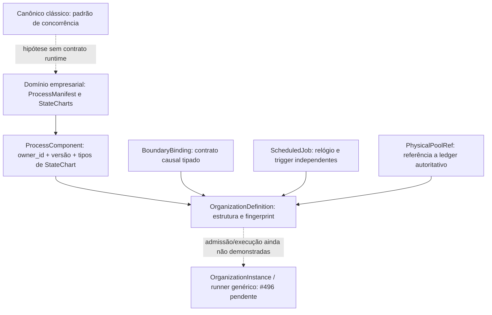

# SOSE — Matriz canônicos × domínios × organizações (v1)

> **Evidência em vez de ontologia especulativa.** Inventário versionado associado a `canonical-domain-organization-matrix.v1.json`, conferido por `tests/unit/sose/examples/test_canonical_domain_organization_matrix.py`. Base inicial: `main` em `42778f0` (2026-10-16). Arquétipos são *templates propostos*, não instâncias admitidas. Esta matriz não altera `NOT_ADMITTED` do OD-5a.

## Convenções de evidência

| Sinalização | Significado |
| --- | --- |
| **Registrado** | `DomainDefinition(kind="canonical" | "domain")` efetivamente inscrito em `builtin_catalog` |
| **Auditado PC5/PC6** | `ProcessManifest` com `assessment_complete=True`; recursos e contratos listados exatamente como atestados |
| **PC0*** | Limite inferior da auditoria não concluída, **não** prova ausência de processo, recurso ou contrato |
| **Hipótese de canônico** | Comparação de mecanismos úteis ao domínio; **não** é import, composição runtime ou prova de mecanismo executado |
| **Fluxo composto executável delimitado** | `BoundaryConsumerRegistry` com contratos/versionamento reais e testes de fluxo; **não** é `OrganizationInstance` executável genérica nem promoção automática dos produtores a PC6 |
| **Arquétipo proposto** | Lista de componentes potenciais; `owner_id`, `ScheduledJob`, `PhysicalPoolRef` e `config_epoch` ainda sem vínculo/admissão reais |

## 1. Canônicos clássicos (5)

| Padrão | Mecanismo e código |
| --- | --- |
| `producer_consumer` (**P/C**) | Bounded FIFO buffers, backpressure and producer/consumer flow — [registro](../../src/sose/examples/canonical/producer_consumer.py) |
| `sleeping_barber` (**SB**) | Finite service, queue admission and abandonment — [registro](../../src/sose/examples/canonical/sleeping_barber.py) |
| `dining_philosophers` (**DP**) | Concurrent acquisition of multiple scarce resources — [registro](../../src/sose/examples/canonical/dining_philosophers.py) |
| `readers_writers` (**RW**) | Concurrent reads, exclusive writers and priority — [registro](../../src/sose/examples/canonical/readers_writers.py) |
| `job_shop` (**JS**) | Precedence-constrained multi-machine scheduling — [registro](../../src/sose/examples/canonical/job_shop.py) |

`tutorial_job` é um domínio didático de jobs duráveis, deliberadamente excluído da auditoria de processos empresariais; não é um sexto canônico.

## 2. Domínios (22) e decomposição *hipotética* em canônicos

**Regra:** padrão canônico proposto ≠ binding executável. `ProcessManifest.resources` enumera **tipos/names de capacidade atestados** e não endereços de instâncias físicas ou existência de pool partilhado.

| Domínio do catálogo | Canônicos hipotéticos | PC auditado | Recursos auditados (ou ?) | Fronteiras atestadas |
| --- | --- | --- | --- | --- |
| [`airports`](../../src/sose/examples/airports/definition.py) | SB + DP + JS | PC0* | ? (sem auditoria) | ? |
| [`aviation`](../../src/sose/examples/aviation/definition.py) | JS + DP + SB | PC0* | ? (sem auditoria) | ? |
| [`cards_payments`](../../src/sose/examples/cards_payments/definition.py) | P/C + RW + SB | PC5 | `authorization_processor`, `dispute_analyst`, `settlement_processor` | 0 in / 0 out |
| [`construction`](../../src/sose/examples/construction/definition.py) | JS + DP + P/C | PC0* | ? (sem auditoria) | ? |
| [`credit_loans`](../../src/sose/examples/credit_loans/definition.py) | SB + RW + P/C | PC0* | ? (sem auditoria) | ? |
| [`energy_utilities`](../../src/sose/examples/energy_utilities/definition.py) | P/C + DP + RW | PC0* | ? (sem auditoria) | ? |
| [`field_service`](../../src/sose/examples/field_service/definition.py) | SB + JS + DP | PC0* | ? (sem auditoria) | ? |
| [`hospitality`](../../src/sose/examples/hospitality/definition.py) | SB + P/C + DP | PC0* | ? (sem auditoria) | ? |
| [`hospitals`](../../src/sose/examples/hospitals/definition.py) | SB + DP + JS | PC0* | ? (sem auditoria) | ? |
| [`insurance`](../../src/sose/examples/insurance/definition.py) | SB + RW + P/C | PC0* | ? (sem auditoria) | ? |
| [`itsm`](../../src/sose/examples/itsm/definition.py) | SB + P/C + RW | PC0* | ? (sem auditoria) | ? |
| [`logistics`](../../src/sose/examples/logistics/definition.py) | SB + DP + JS | PC5 | `delivery_courier`, `destination_dock`, `origin_dock`, `pickup_courier`, `transfer_vehicle` | 0 in / 0 out |
| [`manufacturing`](../../src/sose/examples/manufacturing/definition.py) | JS + DP + P/C | PC5 | `machine`, `operator` | 0 in / 0 out |
| [`mro`](../../src/sose/examples/mro/definition.py) | JS + DP + SB | PC5 | `maintenance_bay`, `spare_parts`, `technician` | 0 in / 0 out |
| [`order_to_cash`](../../src/sose/examples/order_to_cash/definition.py) | P/C + SB + RW | PC5 | `collection_agent`, `fulfillment_team` | 0 in / 0 out |
| [`p2p`](../../src/sose/examples/p2p/definition.py) | P/C + SB + RW | PC5 | `inspector`, `receiving_dock` | 0 in / 0 out |
| [`record_to_report`](../../src/sose/examples/record_to_report/definition.py) | RW + P/C + JS | PC5 | `close_accountant`, `posting_processor`, `reconciliation_analyst` | 0 in / 0 out |
| [`subscription_saas`](../../src/sose/examples/subscription_saas/definition.py) | P/C + RW + SB | PC0* | ? (sem auditoria) | ? |
| [`telecom`](../../src/sose/examples/telecom/definition.py) | P/C + SB + RW | PC0* | ? (sem auditoria) | ? |
| [`transit`](../../src/sose/examples/transit/definition.py) | SB + DP + P/C | PC0* | ? (sem auditoria) | ? |
| [`warehouse_fulfillment`](../../src/sose/examples/warehouse_fulfillment/definition.py) | P/C + JS + DP | PC6 | `fulfillment_picker`, `packing_station`, `shipping_dock` | 2 in / 3 out |
| [`warehouse_management`](../../src/sose/examples/warehouse_management/definition.py) | P/C + DP + JS | PC5 | `dock`, `forklift`, `truck` | 0 in / 0 out |

*PC0: limite inferior conservador. Só nove dos 22 domínios têm `assessment_complete=True` nesta revisão. Até onde o `ProcessManifest` audita, Warehouse Fulfillment atinge PC6; os outros oito atingem PC5. Fluxos compostos reais não substituem a proveniência e os gates PC6 para cada domínio.

**Contratos com procedência de auditoria PC6:** `warehouse_fulfillment` declara `ingress` `o2c.fulfillment_requested.v1`, `warehouse.inventory_reserved.v1` e `egress` `warehouse.dispatch_ready.v1`, `warehouse.inventory_consumption_requested.v1`, `warehouse.inventory_reservation_requested.v1`. Para os demais PC5, *zero contratos atestados pelo manifest* não quer dizer zero contratos implementados; para PC0*, direção/versionamento permanecem desconhecidos pela auditoria.

## 3. Organização como composição de **componentes de processo**

O contrato de estrutura `src/sose/composition/organization.py` implementa `ProcessComponent`, `BoundaryBinding`, `ScheduledJob`, `PhysicalPoolRef`, `OrganizationDefinition` e validação estática. **Organizações abaixo são arquétipos, não objetos `OrganizationDefinition` prontos ou admitidos**; por isso todos os proprietários operacionais e pools físicos permanecem explicitamente não vinculados. Nenhuma linha afirma criar StateCharts ou clocks globais.

| Arquétipo organizacional | Componentes de domínio (propostos) | Situação |
| --- | --- | --- |
| **Trading Company** (`trading_company`) | `order_to_cash`, `warehouse_fulfillment`, `warehouse_management`, `logistics`, `cards_payments`, `record_to_report`, `p2p` | Dois fluxos delimitados executados; runtime genérico pendente |
| **Industrial Manufacturing Company** (`industrial_manufacturer`) | `manufacturing`, `mro`, `warehouse_management`, `p2p`, `logistics`, `record_to_report` | Arquétipo proposto; sem execução ou admissão atestada |
| **Construction Company** (`construction_company`) | `construction`, `field_service`, `p2p`, `warehouse_management`, `logistics`, `mro`, `record_to_report` | Arquétipo proposto; sem execução ou admissão atestada |
| **Airport Operations Ecosystem** (`airport_ecosystem`) | `airports`, `aviation`, `mro`, `logistics`, `transit`, `hospitality` | Arquétipo proposto; sem execução ou admissão atestada |
| **Transport Operator** (`transport_operator`) | `transit`, `mro`, `logistics`, `cards_payments` | Arquétipo proposto; sem execução ou admissão atestada |
| **Utility Company** (`utility_operator`) | `energy_utilities`, `field_service`, `mro`, `warehouse_management`, `record_to_report` | Arquétipo proposto; sem execução ou admissão atestada |
| **Digital Service Provider** (`digital_service_provider`) | `telecom`, `subscription_saas`, `itsm`, `cards_payments`, `record_to_report` | Arquétipo proposto; sem execução ou admissão atestada |
| **Financial Services Group** (`financial_services_group`) | `credit_loans`, `insurance`, `cards_payments`, `record_to_report` | Arquétipo proposto; sem execução ou admissão atestada |
| **Hospital Network** (`hospital_network`) | `hospitals`, `warehouse_management`, `p2p`, `mro`, `cards_payments`, `record_to_report` | Arquétipo proposto; sem execução ou admissão atestada |
| **Hospitality Operator** (`hospitality_operator`) | `hospitality`, `p2p`, `warehouse_management`, `field_service`, `cards_payments` | Arquétipo proposto; sem execução ou admissão atestada |

A mesma definição de domínio pode servir a organizações independentes, mas *compartilhar o módulo* não compartilha `owner_id`, `correlation_id`, entidade, relógio lógico ou reserva física. Para organizações múltiplas, `ProcessComponent` exige binding explícito e a mesma identidade de recurso só pode ser compartilhada quando o ledger autoritativo prova ownership/capacidade.

## 4. Fluxos **efetivamente implementados** e contratos causais no código

Estes contratos foram coletados dos registradores de consumidores da Trading Company. Os nomes e versões abaixo são **declarações executáveis de `BoundaryConsumerRegistry`**, não prova de que todos os respectivos domínios foram admitidos PC6 pelo `ProcessManifest`. `o2c.fulfillment_requested` suporta registro v1 e v2 no fluxo; a execução escolhe a versão conforme o contexto. `p2p` no catálogo aparece como `procure_to_pay` no envelope de fronteira (alias **observado**, não renomeação de ownership).

### `trading_customer` — [código](../../src/sose/composition/trading_company_customer.py)

| Produtor (catálogo) | Consumidor (catálogo) | Contrato / versão registrada |
| --- | --- | --- |
| `order_to_cash` | `warehouse_fulfillment` | `o2c.fulfillment_requested.v1` |
| `order_to_cash` | `warehouse_fulfillment` | `o2c.fulfillment_requested.v2` |
| `warehouse_fulfillment` | `warehouse_management` | `warehouse.inventory_reservation_requested.v1` |
| `warehouse_management` | `warehouse_fulfillment` | `warehouse.inventory_reserved.v1` |
| `warehouse_fulfillment` | `warehouse_management` | `warehouse.inventory_consumption_requested.v1` |
| `warehouse_fulfillment` | `logistics` | `warehouse.dispatch_ready.v1` |
| `logistics` | `order_to_cash` | `logistics.delivery_completed.v1` |
| `order_to_cash` | `cards_payments` | `o2c.payment_requested.v1` |
| `cards_payments` | `record_to_report` | `accounting.entry_requested.v1` |

Provas: [test_trading_company_customer_path.py](../../tests/integration/sose/composition/test_trading_company_customer_path.py); [test_trading_company_recovery_conformance.py](../../tests/integration/sose/composition/test_trading_company_recovery_conformance.py); [test_pc6_two_real_customer_paths.py](../../tests/integration/sose/composition/test_pc6_two_real_customer_paths.py) (**executa e verifica a fronteira v2**).

### `trading_replenishment` — [código](../../src/sose/composition/trading_company_replenishment.py)

| Produtor (catálogo) | Consumidor (catálogo) | Contrato / versão registrada |
| --- | --- | --- |
| `warehouse_management` | `p2p` | `warehouse.replenishment_requested.v1` |
| `p2p` | `warehouse_management` | `p2p.inventory_receipt_ready.v1` |
| `p2p` | `record_to_report` | `accounting.entry_requested.v1` |

Provas: [test_trading_company_replenishment_path.py](../../tests/integration/sose/composition/test_trading_company_replenishment_path.py); [test_trading_company_recovery_conformance.py](../../tests/integration/sose/composition/test_trading_company_recovery_conformance.py).

## 5. Recursos físicos: distinguir tipo, instância, reserva, pool e organização

| Camada | O que a matriz efetivamente prova | O que **não** prova |
| --- | --- | --- |
| Manifest de domínio (`resources`) | Tipos/names de capacidade auditados por domínio PC5/PC6 | ID de instância, disponibilidade temporal ou capacidade numérica de qualquer execução particular |
| Fonte autoritativa SOSE | `ResourceDefinition`, `ResourceReservation` e conflitos/fencing em cada operação | Presença de uma instância específica no momento da consulta deste inventário estático |
| `PhysicalPoolRef` organizacional | Identificador/owner de **referência** para um pool externo | Ledger duplicado, owner automaticamente atribuído, pool admitido ou arbitragem global |
| SimPy | Executa requests/grants/release de forma efêmera sob adaptador nativo | Fonte da verdade durável ou semântica de commit distribuído |

**Passo #477:** antes de compor pools entre organizações, certificar identidade de cada lease, reservas autoritativas de capacidade N, espera/retry persistentes, fairness e recuperação PostgreSQL/rede. O pool por organização em [PR #514](https://github.com/brunolnetto/sose/pull/514) é incremental/draft e **não prova compartilhamento multi-organização**.

## 6. Gates de promoção

1. O teste da matriz exige igualdade exata dos **cinco** registros canônicos e **22** domínios do catálogo, excluindo `tutorial_job`, e espelha a maturidade do **manifest** (não de nomes de arquivos). Maturidade PC0* não pode virar PC5 nem recursos desconhecidos virar lista vazia.
2. Recursos, ingressos, egressos e direções auditadas devem ser exatamente os declarados em `ProcessManifest`; a inclusão de contrato tipado requer fonte e proveniência, não strings genéricas. A associação `procure_to_pay` (wire) → `p2p` (catálogo) é explicitamente validada contra o import do domínio real, e não pode ser remapeada por edição do inventário.
3. Os registros de fronteira dos dois fluxos são comparados via AST com `BoundaryConsumerRegistry.register` real — nome, versão, origem e destino (com alias explícito), negando contratos inventados. Cada versão também precisa aparecer em uma **asserção dentro de teste que executa o flow**; um registro de handler sem teste de passagem (como `o2c.fulfillment_requested.v2`) não basta. Adicionalmente, um **teste de execução independente** roda Customer Demand padrão (v1), Customer Demand com `instance_key` (v2) e Replenishment; lê **somente** as mensagens apontadas por `result.message_ids` no `result.persistence`, verifica a correlação de cada mensagem e exige igualdade exata de `(source_domain, destination_domain, contract_name, contract_version)` com o inventário. Strings soltas ou mensagens sem vínculo com o resultado não contam.
4. Arquétipos não podem se autodeclarar executáveis: os dois fluxos têm testes reais, enquanto o executor `OrganizationInstance` aguarda #496 e a heterogeneidade O2C/MRO aguarda #497.
5. Alterações em pertencimento canônico são **hipóteses** a discutir e falsificar caso a caso; não se deve alterar o kernel ou um `DomainDefinition` sem um contrato separado, TDD e ADR quando necessário.
6. O estado científico OD-5a permanece `NOT_ADMITTED`; PC6 genérico, gates físicos #477, #496/#497 e a admissão prospectiva #461 têm escopos separados.

Fontes normativas: [Process Canonical Roadmap](process-canonical-roadmap.md), [Organization Composition Contract v1](organization-composition-contract-v1.md), [Organizational Composition Roadmap](organizational-composition-roadmap.md), [ADR-0006 de fronteira causal](decisions/adr-0006-cross-domain-boundary-messages.md).
