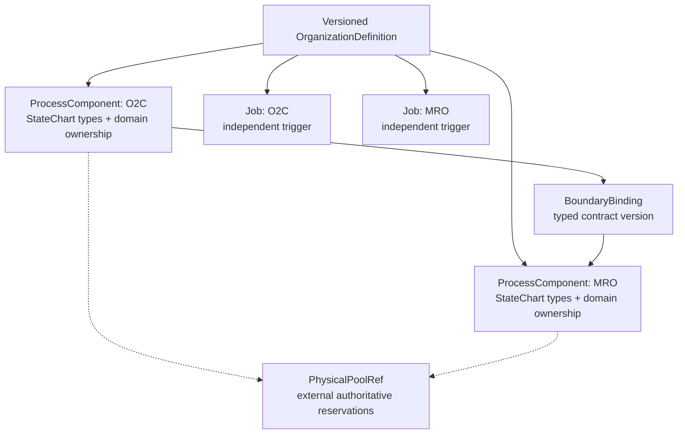

# Organization Composition — initial configuration contract (issue #495)

Status: **partial implementation slice / proposed ADR** (2026-10-13).
Follow-up: #496 executable runtime, #497 O2C/MRO domain falsifier, #468/#489 concurrency, #477 physical adapter.
Master plan: #494; proposed documentation: #498.

## PRD / objective

Define a small immutable representation of an organization as a collection of independently
owned **process components**, each identifying the *StateChart types* it may instantiate,
plus typed cross-component boundary bindings, independently triggered jobs and references
to authoritative physical resource pools. This configuration never instantiates an
entire organization's Cartesian-product StateChart.

A component is a *process reference*, not the persistent owner of all its business
entities. A `PhysicalPoolRef` is a reference, **not** an allocation or a duplicate
resource-capacity ledger. This module does not select policies, issue Commands, execute
SimPy, admit scientific runs or materialize a writable organization-level state.

## Structural contract implemented in this slice

`sose.composition.organization` exports the following **provisional** types:

- `ProcessComponent(component_id, domain, owner_id, statechart_types, process_version)`
- `BoundaryBinding(producer_id, consumer_id, contract_name, contract_version)`
- `ScheduledJob(job_id, component_id, trigger_namespace)`
- `PhysicalPoolRef(pool_id, owner_id, consumer_ids)`
- `OrganizationDefinition(organization_id, version, components, boundaries, jobs, physical_pools, config_epoch)`

Definitions validate nonempty canonical identities, version and epoch ranges,
duplicate component/owner, duplicate job/trigger, dangling boundary or pool references,
self-targeted cross-process boundaries, and duplicate exact boundary edges.
Definitions are immutable, and a canonical SHA-256 fingerprint changes when
the semantic configuration changes.

**Identity warning:** `organization_id` is not derived from an individual flow
`correlation_id`; neither are per-component or shared-resource owner identities.
An organizational configuration does not silently create a new scoped PostgreSQL
writer owner, global clock, or namespace-wide transaction.

**Graph cycles:** structural feedback loops may be valid cross-domain business
behavior. The schema intentionally does not reject *every* directed cycle; cyclic
dependency admission, deadlock and liveness are separate typed operational
contracts, to be specified before executing a cyclic dependency in #496.

## Mermaid — composition versus ownership

## TDD evidence

`tests/unit/sose/composition/test_organization_definition.py` contains
negative cases for invalid IDs and versions, duplicates, wrong ownership,
dangling/self/duplicate boundaries, duplicate/dangling jobs and pool
consumers, plus positive cases for two process components, disjoint job
triggers, explicit physical ownership and stable/sensitive fingerprints.

The test contract was committed before the production implementation.
No PostgreSQL/SimPy behavior is claimed by these structural tests.

## ADR (proposed — full #495 ratification still outstanding)

**Decision:** put these immutable composition-definition types **above the
generic SOSE kernel** in the existing composition package. Preserve the
independent business truth of each domain and the existing PC6 ownership,
DomainEvent, Command, boundary claim/ACK and certified effects.

**Alternatives rejected:** monolithic organization StateChart, mutable
organization-state snapshot, reusing flow correlation as organization ID,
shadow physical ledger, implicit shared clock and global UoW.

**Consequence:** the executable binder in #496 must independently verify
that every named boundary exists in the versioned ingress/egress contract
registry and that every StateChart type is actually supported by its
domain. This initial syntactic contract **does not validate registry
capabilities**. A constructor accepting a string does not mean a domain
runtime implements that StateChart, a physical pool exists, or a cyclic
dependency can run. Admission must fail closed at runtime binding.

**No scientific gate added:** OD-5a #461 remains NOT_ADMITTED pending its
existing #477 and prospective freeze gates; O2C/MRO #497 and actor or
management lifecycle features do not retroactively gate it.

## Remaining #495 acceptance before close

1. Binding validation against the real versioned PC6 ingress/egress
   registry and the domain process manifest (not just names).
2. An explicit topology policy and rejection behavior for impossible
   dependency cycles and missing ownership, with small happy/sad
   executable examples.
3. Ratification of governance StateChart versus projection semantics
   and lifecycle/epoch binding contracts.
4. Architecture review, type/schema conformance and source-linked
   evidence, before claiming this provisional contract is a stable API.
