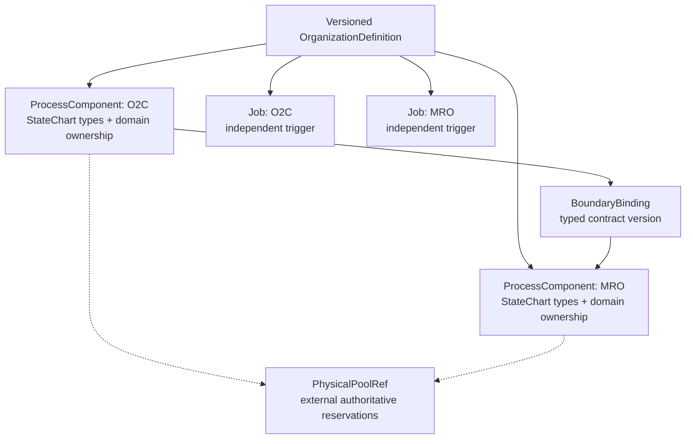

# Organization Composition — initial configuration contract (issue #495)

Status: **immutable structural contract (#499) and fail-closed static runtime admission (#510) in `main`; [composition-admission ADR-0008](decisions/adr-0008-organization-composition-admission.md) Proposed** (2026-10-16).
Follow-up: #496 executable runtime, #497 O2C/MRO domain falsifier, #468/#489 concurrency, #477 physical adapter.
Master plan: #494; proposed documentation: #498.

## PRD / objective

Define a small immutable representation of an organization as a collection of independently
owned **process components**, each identifying the *StateChart types* it may instantiate,
plus typed cross-component boundary bindings, independently triggered jobs and references
to authoritative physical resource pools. This configuration never instantiates an
entire organization's Cartesian-product StateChart.

A component is a *process reference*, not the persistent owner of all its business
entities. A `PhysicalPoolRef` is a reference, **not** an allocation or a duplicate
resource-capacity ledger. This module does not select policies, issue Commands, execute
SimPy, admit scientific runs or materialize a writable organization-level state.

## Structural contract implemented in this slice

`sose.composition.organization` exports the following **provisional** types:

- `ProcessComponent(component_id, domain, owner_id, statechart_types, process_version)`
- `BoundaryBinding(producer_id, consumer_id, contract_name, contract_version)`
- `ScheduledJob(job_id, component_id, trigger_namespace)`
- `PhysicalPoolRef(pool_id, owner_id, consumer_ids)`
- `OperationalConfigReference(component_id, kind, reference_id, reference_version, source_sha256, config_epoch)` — immutable structural declaration of `policy`, `calendar` or `cost_model` only; not executable authority
- `OrganizationDefinition(organization_id, version, components, boundaries, jobs, physical_pools, config_epoch, operational_configs)` — `operational_configs=()` by default, preserving v1 fingerprint bytes when absent

Definitions validate nonempty canonical identities, version and epoch ranges,
duplicate component IDs and duplicate `(domain, owner_id)` pairs (not owner IDs globally), duplicate job/trigger, dangling boundary or pool references,
self-targeted cross-process boundaries, and duplicate exact boundary edges.
Definitions are immutable, and a canonical SHA-256 fingerprint changes when
the semantic configuration changes.

**Identity warning:** `organization_id` is not derived from an individual flow
`correlation_id`; neither are per-component or shared-resource owner identities.
An organizational configuration does not silently create a new scoped PostgreSQL
writer owner, global clock, or namespace-wide transaction.

**Graph cycles:** structural feedback loops may be valid cross-domain business
behavior. The definition constructor intentionally does not reject every
directed cycle, but `validate_organization_admission` rejects any active
cyclic boundary until a separately certified typed liveness policy exists.
Schema validity is deliberately weaker than execution admission.

## Mermaid — composition versus ownership

## TDD evidence

`tests/unit/sose/composition/test_organization_definition.py` contains
negative cases for invalid IDs and versions, duplicates, wrong ownership,
dangling/self/duplicate boundaries, duplicate/dangling jobs and pool
consumers, plus positive cases for two process components, disjoint job
triggers, explicit physical ownership and stable/sensitive fingerprints.

The test contract was committed before the production implementation.
No PostgreSQL/SimPy behavior is claimed by these structural tests.

## Static admission now implemented in `main` (#510)

`validate_organization_admission(definition, catalog=..., manifests=..., consumers=...)`
rejects configurations that cannot be attested by the *real* domain
registrations. Its validated fingerprint is a configuration identity, **not**
an executable job, runtime state snapshot or scientific certificate.

- StateChart classes come from immutable `DomainDefinition.registered_entity_types`
  metadata shared with runtime registration. Introspection never calls
  `seed()`, `default_config()` or `build_runtime()`.
- Each component needs an audited domain `ProcessManifest`, the exact
  process version and actually registered chart names. Current manifests
  attest process **v1 only**: v2 cannot reuse v1 evidence.
- Every directed boundary requires audited, per-direction/name/version
  ingress/egress provenance and a callable
  `BoundaryConsumerRegistry` handler registered for the exact
  source-domain / destination-domain / contract / version tuple.
- Cycles without independently certified liveness fail closed.
- The registry currently dispatches by domain, **not by component/owner**.
  Therefore connected duplicate-domain components with independent owners
  are rejected; disconnected same-domain components can be admitted.
- Warehouse Management's built-in manifest does not currently attest
  `warehouse.inventory_reservation_requested.v1` ingress. Tests using a
  *hypothetical* audited manifest are validator falsifiers, not evidence
  that this production ingress exists.

Evidence: `src/sose/composition/organization.py`,
`tests/unit/sose/composition/test_organization_runtime_admission.py`,
`src/sose/composition/boundary.py`, and
[ADR-0008](decisions/adr-0008-organization-composition-admission.md).
The CI and historical three-domain replay on
[#510](https://github.com/brunolnetto/sose/pull/510) passed before merge
[`11af3b9`](https://github.com/brunolnetto/sose/commit/11af3b96c952b0c8cf4afa5d85ec646c8b90d6e9).

## ADR (proposed — full #495 ratification still outstanding)

**Decision:** put these immutable composition-definition types **above the
generic SOSE kernel** in the existing composition package. Preserve the
independent business truth of each domain and the existing PC6 ownership,
DomainEvent, Command, boundary claim/ACK and certified effects.

**Alternatives rejected:** monolithic organization StateChart, mutable
organization-state snapshot, reusing flow correlation as organization ID,
shadow physical ledger, implicit shared clock and global UoW.

**Consequence:** the *static* runtime binder now validates registered chart
types, audited manifest contracts, exact consumer handlers and unsupported
cycles; the constructor by itself still does not. This attestation does
**not** prove that an external physical pool exists, policy/calendar/cost
references are well-formed, jobs are instantiated, an organizational
projection is consistent, or a boundary effect survives a worker restart.
Those require separate, fail-closed execution and persistence contracts.

**No scientific gate added:** OD-5a #461 remains NOT_ADMITTED pending its
existing #477 and prospective freeze gates; O2C/MRO #497 and actor or
management lifecycle features do not retroactively gate it.

## #495 acceptance reconciliation (not yet ratified)

| Original criterion | Demonstrated in `main` | Still unproven / necessary decision |
| --- | --- | --- |
| Identity and ownership | Distinct organization, component owner, job and pool-owner fields; duplicate `(domain, owner_id)` **pairs** rejected (#499), but a raw `owner_id` may be reused across different domains | Formal source-entity/flow and shared-pool owner binding across running components (#496) |
| Charts, versions, contracts | Real registry metadata and audited direction/version-specific manifests + callable handlers (#510) | Audited production WF→WM ingress; multiple connected same-domain owners require exact component/owner routing, or an explicit v1 unsupported limitation |
| Topology | Dangling dependencies and self-boundaries rejected; cyclic execution admission fails closed (#499/#510) | Explicit certified liveness policy for allowed cycles, if supported |
| Configuration | `config_epoch` and immutable `OperationalConfigReference(component_id, kind, reference_id, reference_version, source_sha256, config_epoch)` are type-checked; invalid/dangling/duplicate/mismatched epochs rejected and fingerprints include references (PR #530). Registry admission **fails closed** on unaudited operational references | Runtime policy/calendar/cost registry attestation, epoch transition, stale-worker fencing and invalidation contract (#496) |
| Physical resources | Named external pool references with explicit owner IDs and known consumer IDs; duplicate pool IDs rejected (#499) | Pool existence, calendar/instance/capacity and transactional ownership checked against one authoritative ledger |
| Causal execution | Exact registry admission but **no runnable composition** (#510) | Publication → claim → fenced ACK → Command → certified effect across components with restart and local clocks (#496) |
| Read model / governance | Architectural separation described by [composition-admission ADR-0008](decisions/adr-0008-organization-composition-admission.md) | Derived consistent snapshots, optional authority-changing governance StateChart and failure-path conformance (#496) |
| Architecture ratification | [Composition-admission ADR-0008](decisions/adr-0008-organization-composition-admission.md) Proposed; schema + negative admission tests. A different proposed [owner-qualified runtime ADR-0009](decisions/adr-0009-owner-qualified-runtime-only.md) has a distinct identifier and is **not** this decision | Independent review of the full PRD/TRD, policy/epoch semantics, versioned API and explicit scope decision |

**Stop rule:** do not interpret #510's static validator, hypothetical manifest,
or historical replay as a complete production composition, a ratified ADR or
the five-arm OD-5a scientific seal. Close #495 only after the missing
contract-level acceptance is either implemented and tested or explicitly
resolved by an independently reviewed ADR scope decision.

## Operational configuration: structural facts are not installed capabilities (#530)

`OperationalConfigReference` is a frozen **claim of referenced configuration**,
NOT the authority to run a policy, use a calendar, or charge a cost. It binds
exact component ownership, `policy` / `calendar` / `cost_model` kind,
positive version, lowercase source SHA-256 and the organization `config_epoch`.
Unknown component, contradictory epoch, repeated component+kind (including
conflicting version/digest), malformed hash and invalid version fail on
construction. Reordering references does not change the definition fingerprint;
changing any referenced hash/version/epoch does.

Because no audited operational configuration registry with policy/calendar/cost
semantics exists yet, **`validate_organization_admission` refuses any definition
that has such references**. An arbitrary configuration hash supplied by a caller
must not self-attest existence, authority, calendar availability or cost.
Executable attestation, schema semantics and deterministic epoch migration are
bounded work in #496; not silently retrofitted into #495.

The separate owner-qualified durable runtime decision is
[ADR-0009](decisions/adr-0009-owner-qualified-runtime-only.md);
admission of structural composition remains the *proposed*
[ADR-0008](decisions/adr-0008-organization-composition-admission.md).
Do not treat unique numbering as architectural ratification.
