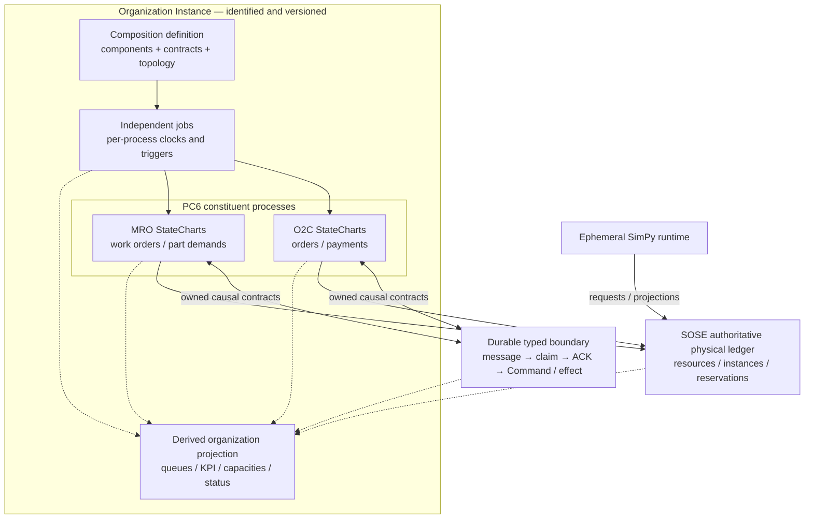

# Organizational StateChart Composition — integrated SOSE roadmap

> **Status:** proposed architecture contract and execution plan (2026-10-13).
> **Tracking:** [#494](https://github.com/brunolnetto/sose/issues/494); [#495](https://github.com/brunolnetto/sose/issues/495) contract, [#496](https://github.com/brunolnetto/sose/issues/496) runtime, [#497](https://github.com/brunolnetto/sose/issues/497) heterogeneous falsifier.
> **Existing gates:** [#468](https://github.com/brunolnetto/sose/issues/468) and [#489](https://github.com/brunolnetto/sose/issues/489) concurrency, [#477](https://github.com/brunolnetto/sose/issues/477) native physical conformance, [#461](https://github.com/brunolnetto/sose/issues/461) OD-5a.
>
> This document is a roadmap and proposed normative boundary, **not an assertion that an Organizational Composition runtime already exists**.

## PRD — scientific and operational purpose

A modeled organization consists of autonomous domain processes and individual entity StateCharts whose progress depends on *typed causal interactions*, finite resources, business rules, calendars, scheduling and policy. A production organization must be able to restart and continue without serializing all components or rewriting source facts from another domain.

Two distinct concepts must **not** be conflated:

- **Organizational Composition** is a versioned configuration and executable interaction graph of processes, StateCharts, contracts, resource ownership and independently scheduled jobs. It is **not** a single super-StateChart or the Cartesian product of local states.
- **Organization Governance StateChart** is optional domain behavior, with durable authority-changing transitions (e.g., admission suspended, reassignment authorized, approved reorganization). A label inferred from metrics, such as `capacity_constrained`, belongs in an observational **projection**; it is not a second authoritative lifecycle state.

The objective is to gain a reusable operational semantics on top of the existing SOSE kernel and PC6 boundary composition, without claiming that similar enum names or standalone StateCharts constitute a working enterprise.

## Component boundaries

| Level | Durable owner | Behavior |
| --- | --- | --- |
| Individual StateChart | Domain/entity owner | Legal transitions, state and local invariants of a specific entity |
| Business process PC0–PC6 | Owning domain + typed ingress/egress | Multi-entity orchestration, source events, Commands, effects and outcome |
| Organization Composition | Component/contract catalog + references to existing durable owners | Dependency graph, policy/calendars, shared resource references and independent job identity |
| Organizational Projection | **No new writable business owner** | A consistent, explicitly timestamped view of local states, queues, resources, causal boundary state and performance |
| Optional Governance StateChart | Explicit governance domain owner | Only real organizational decisions with authenticated/observable operational consequences |

`OrganizationDefinition` and `OrganizationInstance` below are **provisional design concepts**, not implemented SOSE APIs.

A minimal organization definition records component identity/type/version, owned process boundaries, contract versions, explicit dependency edges, resource scope/owner, policy and calendar references, configuration epoch, and per-job schedule identities. It must not substitute one `GenericEnterprise` for distinct business domain models.

### Composition diagram



The diagram is schematic: sharing an organization does **not** make O2C and MRO one transaction, imply that every current catalog example has PC6 maturity, or require them to share all resources.

## TRD — finite operational semantics

Given constituent machine states `S(t)`, authoritative resource/reservation ledger `R(t)`, pending queues `Q(t)`, typed boundary facts `C(t)`, policy/configuration version `P(t)`, and durable job positions `J(t)`, the organizational observation is a *derived* projection

```text
X_org(t, snapshot) = project(S(t), R(t), Q(t), C(t), P(t), J(t))
```

It need not be stored as an independently mutable source of truth. The projection explicitly records timestamp, read consistency and ownership; it cannot silently combine incompatible snapshots.

A component's legal transition is guarded by its own StateChart **and** evidenced dependencies, such as reserved physical capacity, issued material, a valid calendar window and a durable causal parent. Dependencies may be satisfied asynchronously after another process commits its own transition.

**Ownership and identity invariants:**

1. `organization_id`, component/process `owner_id`, per-flow `correlation_id`, `entity_id`, `job_id`, event `causation_id`, and physical `resource_scope` are distinct logical namespaces. Not every event correlation ID is a top-level organization ID.
2. One domain owns each authoritative business entity. Other components read a projection or consume a typed/versioned boundary message; they cannot mutate another domain's private entity.
3. Source `DomainEvent` and boundary transport have immutable causal identity. A consumer owns its ACK/Command and certified effect; a transport ACK by itself is **not** completion of the downstream business effect.
4. No invented organization-wide transaction, global simulation tick or global serialization lock. Jobs and organizations have independent logical clocks, authoritative scheduling identities, owner leases and fencing; causal ordering is partial and explicit.
5. A physically shared pool uses **one authoritative reservation ledger** with finite capacity and temporal/instance ownership. This physical contention does not imply a global coordinator for unrelated jobs.
6. A busy resource yields durable wait/retry/reschedule, not an accidental terminal domain failure. Stale owners and duplicate deliveries do not advance an already-completed transition.
7. Cross-domain commit failure is handled by persisted causal intent, independent stage commits, recovery and idempotent reconciliation; the design does not promise atomic distributed transactions that do not exist.
8. SimPy `Environment`/`Process`/`Event` instances are ephemeral. Only operational semantics, model/config version, positions, causal/physical facts and checkpoints are persisted.
9. Config/policy/topology changes carry epoch/validity and are never applied retroactively to historical frozen runs.
10. Governance is optional; any implemented governance StateChart must prove authorized changes and consequences, never just annotate an existing metric.

## Updated implementation sequence

| Wave | Tracker | Deliverable | Exit gate / stop rule |
| --- | --- | --- | --- |
| W1 — Correct concurrent business truth | #468, #489 | Reproduce store/clock corruption and distinguish Logistics resource wait from real failure under live independent PG workers | Bounded deterministic red cases then green, causal/physical comparison, no serial smoke masking |
| W1a — Composition design (may run in parallel with W1) | #495 | PRD/TRD/ADR, validated catalog contract, organization/flow/owner identity separation, projection/transaction boundaries | Reject dangling/ambiguous ownership, incompatible contract, invalid dependency and calendar configurations; no speculative kernel rewrite |
| W2 — Native physical execution | #477 | Real SimPy physical arbitration on durable finite instances (capacity >1, wait, preemption/release), crash/concurrency equivalence | Five-arm standalone adapter vs reducer vs restarted adapter full causal **and physical** ledger, server/network failure injection, reviewed non-confirmatory evidence |
| W3 — Executable organizational composition | #496 | Bind processes, jobs, dependencies, resources and typed causal contracts into one versioned Organization Instance; project current state | Persistent independent clocks, no global lock, per-owner contract semantics and recovery; standalone components still run |
| W4 — Heterogeneous domain falsifier | #497 | Run O2C and MRO individually and as composed organizations (with explicit inventory/P2P contract or declared reference fixture) | Real PG workers, nontrivial happy/sad paths, continuous/restarted per-commit equivalence and physical capacity invariants |
| W5 — OD-5a prospective science | #461, #457 | Five preregistered structural/capacity arms, independent numeric/source freeze, CRN and scientific report | **Only after its own #477 scientific adapter gate and prospective seal**; results may be null/negative; NOT_ADMITTED until authorized |

**Dependencies are not a single blocking chain.** W1a can precede completion of W1. Parts of W3 may be implemented before W2, but physical contention certification cannot be claimed until W2 is proved. W5 can progress after the OD-5a-specific W2 gate **without waiting for W3/W4**; the new O2C/MRO generality contract may not be imposed retrospectively on the OD-5a preregistration.

## TDD evidence and planned pull-request slices

1. **Contract, ownership and version falsifiers (#495)**: invalid alias `organization_id == correlation_id` assumptions, dangling contract, contradictory owner, incompatible version, unallowed topology, invalid calendar, projection mutability. RED first; positive and negative tiny examples.
2. **Concurrent authoritative defects (#468/#489)**: retained PG same-namespace overlap, collision logs and interleaving ledger; fix lost store/clock and durable wait instead of eventual terminal failure; do not skip or serialize tests.
3. **Native physical adapter (#477)**: instance >1 finite pool, overlap prohibition, queued requests, release/preempt, worker/PG-server failures, three-way physical DAG comparison.
4. **Organization binding and projection (#496)**: consumer ownership and context routing, independent job triggers, causal partial ordering, reader snapshot consistency; recovery between message/claim/ACK/Command/effect.
5. **O2C/MRO falsification (#497)**: physically contested and domain-specific paths, mixed organization jobs, fault schedule, independently reproducible control/oracle evidence, comparison of complete semantic event/reservation/receipt sets rather than aggregate throughput.

Every PR carries isolated red/green tests, exact-head required CI, versioned documentation, review and a bounded stop rule. Extract generic APIs only when repeated duplication is demonstrated by real domains; do not change immutable Manufacturing, O2C or MRO v1 historical source/replay claims.

## ADR — decision record (proposed, to be ratified in #495)

**Decision:** keep Organization Composition **above** the SOSE generic kernel, built from existing StateCharts, PC6 contracts, authoritative persistence, scheduling and finite physical resources. Treat its organizational state as a derived projection, not a second writable business state. Optional governance is a separate owned domain machine. No global lock/clock and no mandatory distributed atomic COMMIT.

**Alternatives rejected:**
- A single Cartesian-product organizational StateChart: state explosion, shared ownership ambiguity, artificial coupling.
- An organization supervisor that directly mutates every domain's private state: violates existing PC6 causal/owner contract.
- Immediately extracting `GenericEnterprise` into the kernel: premature abstraction without two-domain falsification.
- Interpreting one green worker-recovery CI as full native physical conformance or OD-5a scientific admission: unsupported claim.

**Consequence:** composed-state read model must specify snapshot consistency and event versioning. The generic engine remains stable while incremental domain composition demonstrates which interfaces are truly shared.

**Provisional status:** #495 must review/ratify this ADR. No source-level organizational API or scientific seal is claimed by this document.

## Explicit scientific boundary

The OD program #457 retains preregistered interventions, original estimands, numerical bounds, CRN, roots/seeds, cost families, scientific v1 immutable frozen artifacts, and review evidence. OD-5a #461 remains **`NOT_ADMITTED`** until the independent execution-freeze gates pass. The new organizational catalog, actor lifecycle #462, adaptive policy #463, governance #464, heterogeneity #497 and OD-5b #465 are **not** implicit additional conditions of OD-5a. A passing O2C/MRO experiment proves only bounded *heterogeneous operational generality*, not empirical validity or generality to every sector.

References: [process canonical roadmap](process-canonical-roadmap.md), [SOSE historical roadmap](../ROADMAP.md), [#494](https://github.com/brunolnetto/sose/issues/494), [#477](https://github.com/brunolnetto/sose/issues/477), [#461](https://github.com/brunolnetto/sose/issues/461).
